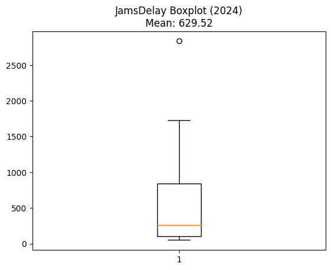
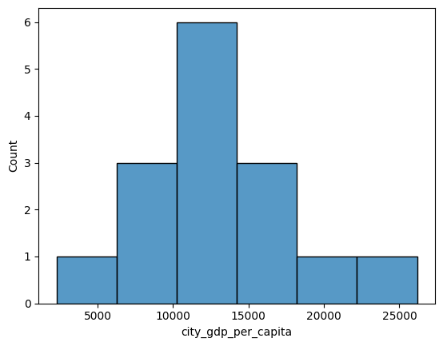
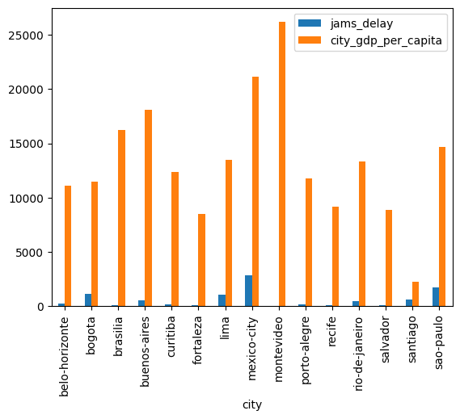

# Urban Mobility and Economic Analysis in Latin America

Urban mobility and economic analysis of 15 Latin American cities using Python and Pandas.
## Project overview

Analysis of mobility, traffic congestion and economic indicators across
15 Latin American cities during 2024.

## Business question

Which Latin American cities present the strongest case for transportation
infrastructure investment based on congestion, economic productivity and
population size?

## Tools

- Python
- Pandas
- Matplotlib
- Seaborn
- Jupyter Notebook

## Process

- Data cleaning and type conversion
- Standardization of city and country names
- Aggregation by city and year
- INNER JOIN of mobility and economic datasets
- Exploratory data analysis
- Visualization of distributions, outliers and general trends

## Data coverage

The analysis used 2024 traffic and economic data from 15 cities across
Argentina, Brazil, Chile, Colombia, Mexico, Peru and Uruguay.

## Methodology

Traffic and economic datasets were cleaned and standardized before integration.
Numeric and date formats were corrected, column names were normalized and both
datasets were filtered to include only 2024 observations.

Traffic indicators were aggregated by city and year using their average values.
The resulting table was combined with GDP per capita and population data through
an INNER JOIN using city and year as keys.

Exploratory analysis was conducted with Pandas, Seaborn and Matplotlib to examine
distributions, outliers and possible associations between urban congestion,
economic productivity and population size.
## Visualizations

### Distribution of average congestion delay

The boxplot shows a strongly skewed distribution and identifies Mexico City as the main congestion outlier.

### GDP per capita distribution

Most cities are concentrated within an approximate GDP per capita range of USD 10,000 to USD 14,000, with a small number of cities reaching higher values.

### Congestion and GDP per capita by city

The comparison does not reveal a clear association between higher GDP per capita and higher average congestion delay.
## Key findings

- No clear association was observed between higher GDP per capita and higher
  average congestion delay. Montevideo, Brasília and Rio de Janeiro recorded
  GDP per capita values above the sample median, while their average
  `jams_delay` values remained below the overall city average.

- Mexico City was the main congestion outlier, with an average `jams_delay`
  close to 2,833 minutes. The overall mean was approximately 629.52 minutes,
  while the median was close to 275 minutes, indicating a strongly skewed
  distribution.

- Population showed a more visible positive association with several traffic
  indicators. Mexico City, São Paulo, Bogotá and Lima combined large
  populations with relatively high levels of congestion, delay and number of
  traffic jams.

- The relationship was not uniform. Buenos Aires had the third-largest
  population and the third-highest GDP per capita in the dataset, but recorded
  substantially lower congestion levels than Mexico City, São Paulo, Bogotá
  and Lima.

- These results indicate that GDP per capita and population size alone are not
  sufficient to explain urban mobility conditions. Additional variables such
  as road capacity, urban structure and public transportation coverage should
  be examined in future analyses.

## Recommendation

Bogotá emerged as the city that best matched the investment criteria defined
for the analysis.

It recorded the highest traffic index in the dataset, at 37.6, while its GDP
per capita of USD 11,442 remained below the sample average of USD 13,253.
Bogotá also had a population of approximately 11.3 million residents.

This combination of high congestion, significant population and below-average
economic productivity suggests that Bogotá could be considered a priority for
transportation infrastructure investment. Improvements in mobility could help
reduce travel delays and support broader urban and economic development.

## Limitations and next steps

The analysis identifies descriptive patterns but does not establish causality.
Future work could include correlation tests, multivariable regression and
additional indicators related to public transportation, road infrastructure,
urban density and geographic distribution.

## Project file

[Open the complete Jupyter Notebook](latam_mobility_economy_analysis.ipynb)

## Author

**Rodrigo Garza García**

- [LinkedIn](https://www.linkedin.com/in/rodrigogarzamx/)
- [Email](mailto:rogarzag@gmail.com)